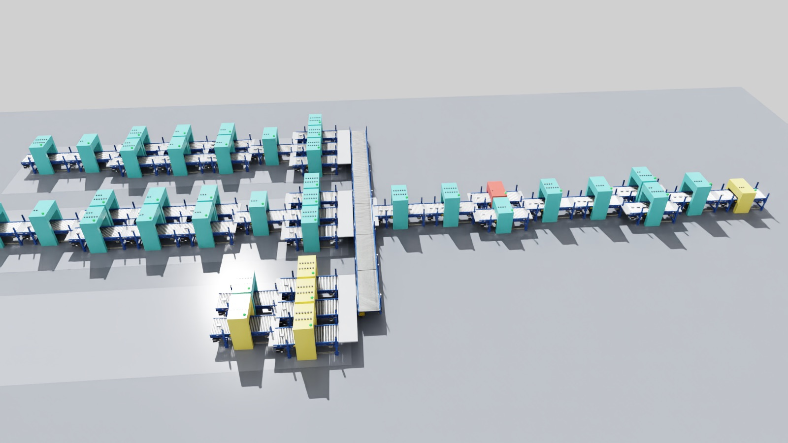
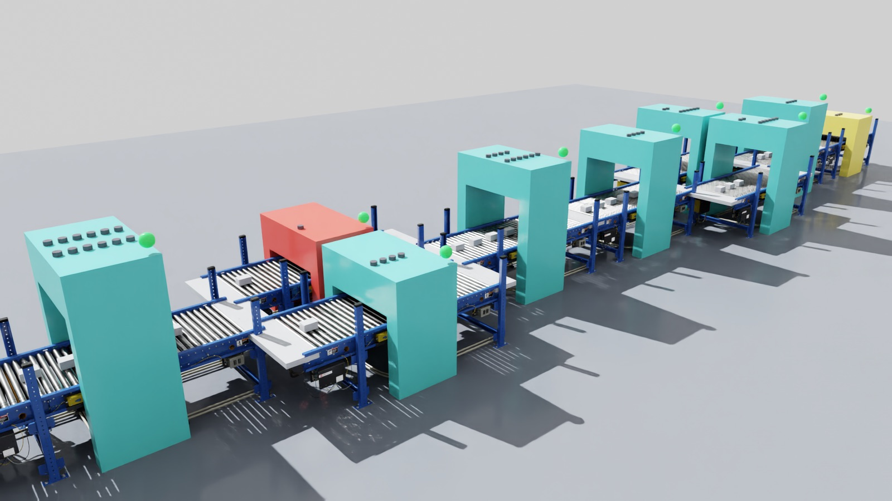
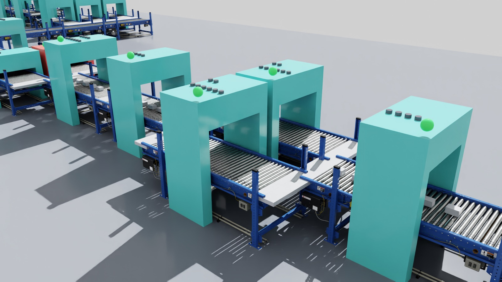
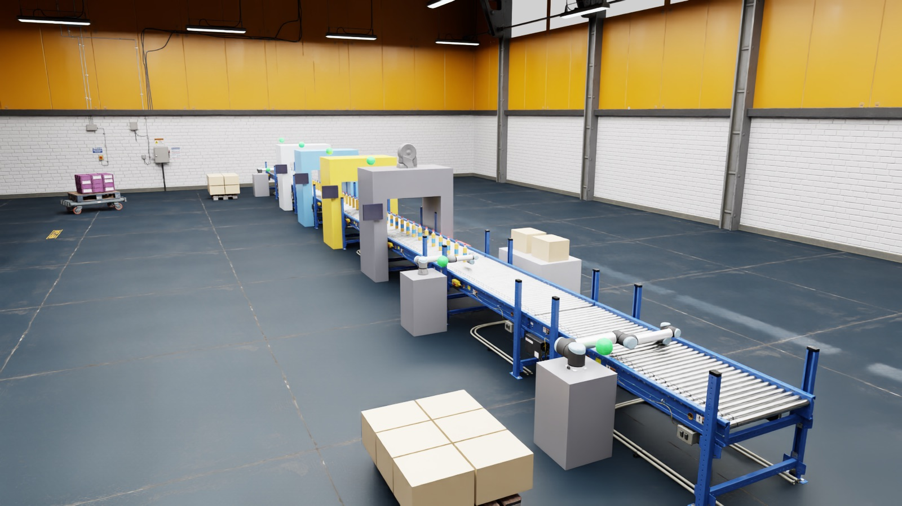
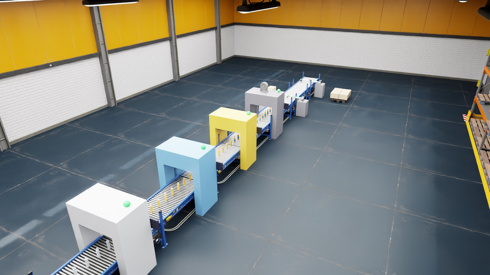
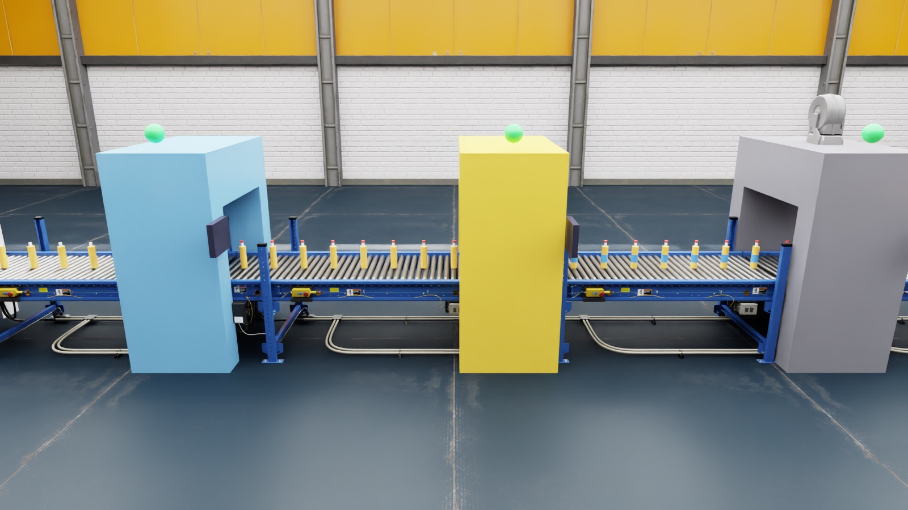
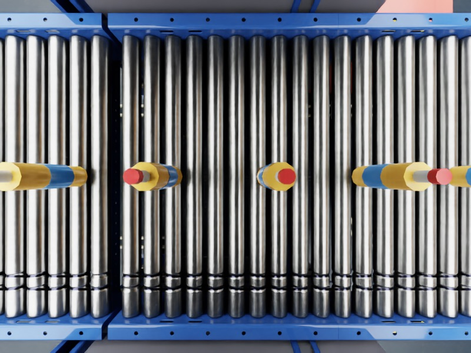

# smartbai: a cognitive digital twin for an SME production line in Dubai

**smartbai** ("smart factory in Dubai") builds a *cognitive digital twin* of a manufacturing line. It follows the direction
of the Dubai Future Foundation RDI project
[*Cognitive Twins: Leveraging Artificial Intelligence and Omniverse-Powered Digital Twins for Transforming Dubai's Manufacturing Sector*](https://rdi.dubaifuture.ae/?p=356).

Here "cognitive" has a concrete meaning. The twin does more than display data: an LLM agent **reads the twin's state,
tests candidate actions with what-if simulations inside the twin, and only then recommends an action**. Every claim the
agent makes must cite an observation produced by the twin.

**Status.**

| Component | State |
|---|---|
| Isaac Sim 6.2 (headless) | done |
| Twin v2, built from the Bosch line structure | done |
| Bottling-line demo scene v1 | done |
| Discrete-event simulator and HTTP tool server | done (validated against the Bosch data) |
| LLM adapter | in progress |
| Decision benchmark (30 pre-registered cases, oracle, scorer, rule baseline) | done ([`eval/`](eval)) |



## Twin v2: a line rebuilt from real production data

The topology and parameters of 39 stations on 4 lines come from the
[Bosch Production Line Performance](https://www.kaggle.com/competitions/bosch-production-line-performance) data:
- the station order, recovered from the timestamps of 1.18 million parts;
- which stations run in parallel;
- the share of parts visiting each station;
- the failure rate of the parts visiting each station;
- the number of sensors per station.

```
 Line 0, branch A (57% of parts): S0 → S1 → (S2|S3) → (S4|S5) → (S6|S7) → S8 → (S9|S10|S11) ─┐
 Line 0, branch B (20%):          S12 → S13 → (S14|S15) → (S16|S17) → (S18|S19) → S20 → (S21|S22|S23) ─┼─► collector
 Line 1 → Line 2 (19%):           (S24|S25) → (S26|S27|S28) ─┘
 Line 3 trunk (~95% of parts):    S29 → S30 → (S31|S32) → S33 → S34 → (S35|S36) → S37 → S38
```

**How to read the scene:**
- **Machine colour** is the failure rate relative to the line average: teal below 1.1×, yellow 1.1–1.5×, orange 1.5–3×, red above 3×. The red station, **S32**, fails about 8× more often than average (4.5% against 0.58%).
- **Sensor pucks on a machine head** show the station's real sensor count, capped at 12.
- **Parts on each belt** are proportional to the station's flow.
- **Every station prim carries its metadata** (line, parallel group, failure rate, parts, sensors) in the USD file, for the tool server to read.

| Trunk with the S32 hot spot (red) | Parallel stations S35 \| S36 |
|---|---|
|  |  |

The Bosch data are subject to the Kaggle competition rules. Neither the data nor the configuration derived from them are
in this repository. To rebuild twin v2, download the data from Kaggle yourself, then run:

```bash
python data_tools/bosch_line_structure.py BOSCH_DIR structure/       # aggregate tables: stations, transitions, routes
python data_tools/make_bosch_twin_config.py structure/ twin_v2_config.json
python twin/build_bosch_line.py twin_v2_config.json out/twin_v2       # Isaac Sim: USD + renders (about 30 s on an RTX 4090)
```

## Bottling-line demo scene (v1)

A small beverage-bottling line in an NVIDIA warehouse:
- **Stations:** depalletising robot (UR10), filler, capper, labeller, vision QC with reject bin, case-packing robot (UR5e), palletising robot (UR10).
- **Bottles** change state as they pass the stations: empty, filled, capped, labelled.
- **QC camera:** a top-down camera at the QC station renders images usable for visual inspection.

| End of line | Overview |
|---|---|
|  |  |
| **Side view** | **QC camera (top-down)** |
|  |  |

## Simulator and tool server

[`sim/line_sim.py`](sim/line_sim.py) is a discrete-event simulator on the twin v2 topology:
- **Routing:** parts follow a Markov chain fitted to the Bosch transition counts.
- **Climate:** hall temperature follows the hourly outdoor temperature in Dubai.
- **Breakdowns:** the failure rate rises with temperature, and every breakdown is preceded by a degradation window in which motor temperature and vibration drift and defects increase.
- **Actions:** speed, preventive maintenance, load split between parallel stations, and cooling.
- **What-if:** `whatif()` runs replicated copies with common random numbers and leaves the twin itself unchanged.

[`sim/tool_server.py`](sim/tool_server.py) exposes the twin to an agent over HTTP:
- the tools are `get_line_state`, `get_station`, `get_sensor_history`, `predict_failure`, `run_whatif`, `schedule_maintenance`, `set_speed`, `set_dispatch` and `submit_decision`;
- every result carries an `observation_id`;
- there is an observation log for evidence checking.

Details are in [`sim/README.md`](sim/README.md); the agent interface is in [`docs/adapter_interface.md`](docs/adapter_interface.md).

```bash
python sim/tool_server.py twin_v2_config.json dubai_hourly_2015_2025.csv --port 8765
curl -X POST localhost:8765/tool/run_whatif -d '{"actions": [{"action": "schedule_maintenance", "station_id": "S2"}], "hours": 12}'
```

**Validation against the Bosch data** (7 simulated days × 3 seeds, in July and in January):

| | Simulator | Bosch |
|---|---|---|
| Correlation of per-station visit shares | 1.0 (max abs. error 1.0–1.3 pp) | |
| Correlation of per-station failure rates | 0.97–0.99 | |
| Overall failure rate | 0.57–0.63% | 0.58% |
| Failure rate at S32 | 3.7–6.0% | 4.51% |
| Median stations per part | 13 | 13 |

Some parameters are not in any public data: MTBF, repair times, temperature sensitivity, sensor models, power and costs.
They are explicit assumptions in `ASSUMED`, reported with every run, until partner data replace them. With the current
assumptions, July produces about 23% more breakdowns than January, and HVAC uses about 6,800 kWh/week in July against
almost none in January.

## Architecture

```
 Dubai context (climate, energy tariff, SME shifts)      Line sensors and machines
                 \                                       /
                  v                                     v
          ┌──────── Omniverse digital twin (state, simulation) ────────┐
          │              ^ what-if queries   | results                   │
          v              |                   v                           │
       Cognitive layer: prediction → reasoning (LLM agent) → decision ───┘
                                 |                     |
                       SME manager (Q&A)        actions back to the line
                                 └── evaluation: scenarios, cost, OEE
```

| Layer | Content | Tools |
|---|---|---|
| 1. Physical/geometric twin | 3D scene: conveyors, stations, cameras, virtual sensors | NVIDIA Isaac Sim 6.2 / Omniverse (OpenUSD) |
| 2. Data | sensor and event streams per station | discrete-event simulator, public data (below) |
| 3. Predictive AI | failure prediction, defects, OEE | PyTorch (`predict_failure` is a baseline for now, AUC 0.785) |
| 4. Cognitive | LLM agent calling twin tools, running what-ifs, submitting evidence-backed decisions | LLM adapter ([`docs/adapter_interface.md`](docs/adapter_interface.md)) |

## Research question

Does an agent that is checked against the twin make better decisions and fabricate less? "Checked against the twin"
means it can call `run_whatif`, and every number it reports must cite a twin observation. It is compared with:
- (a) an agent that can only read data (no what-if);
- (b) fixed rules.

The comparison runs on a scenario set fixed in advance: machine breakdown, rush order, extreme heat and a quality drift.
The metrics are:
- decision correctness;
- cost and output after the decision;
- the rate of claims without evidence.

## Data

| Component | Source | Notes |
|---|---|---|
| Line structure, routes, failure rates | [Bosch Production Line Performance](https://www.kaggle.com/competitions/bosch-production-line-performance) (Kaggle) | competition rules apply: accept them on Kaggle yourself; data not redistributed here |
| Dubai climate | hourly weather 2015–2025 from the [Open-Meteo](https://open-meteo.com) archive (CC BY 4.0) | drives hall temperature, failure rates and HVAC energy |
| UAE industry context | 24 industrial and manufacturing tables from [bayanat.ae](https://bayanat.ae) (UAE open data portal), fetched by `data_tools/fetch_bayanat.py` | licences, employment, value added, producer prices; context and cost parameters |
| Visual inspection (optional) | [VisA](https://github.com/amazon-science/spot-diff) (CC BY 4.0) | baseline in `modules/qc_visa` |

No machine-level data from Dubai factories are public. The Dubai Pulse and data.dubai portals were not reachable from
outside the UAE when we tried. Data from the project's partner SMEs will replace the assumed parameters when available.

## Repository layout

| Path | Content |
|---|---|
| [`PLAN.md`](PLAN.md) | plan and steps (Vietnamese) |
| [`docs/adapter_interface.md`](docs/adapter_interface.md) | interface between the twin and the LLM adapter: tools, evidence rules, runtime limits (Vietnamese) |
| [`sim/`](sim) | discrete-event simulator, validation, HTTP tool server |
| [`eval/`](eval) | decision benchmark: pre-registered protocol, 30 cases, oracle, scorer, rule and no-action agents, case runner |
| [`twin/build_bosch_line.py`](twin/build_bosch_line.py) | twin v2 scene from the Bosch-derived configuration |
| [`twin/build_line.py`](twin/build_line.py), [`twin/line_config.py`](twin/line_config.py) | bottling-line demo scene v1 and its station definitions |
| [`twin/isaac_smoke.py`](twin/isaac_smoke.py) | Isaac Sim headless smoke test (physics + Replicator render) |
| [`twin/probe_assets.py`](twin/probe_assets.py), [`twin/probe_walls.py`](twin/probe_walls.py) | helpers that list NVIDIA assets and warehouse wall positions |
| [`data_tools/bosch_line_structure.py`](data_tools/bosch_line_structure.py) | derive stations, transitions and routes from the Bosch data (aggregates only) |
| [`data_tools/make_bosch_twin_config.py`](data_tools/make_bosch_twin_config.py) | build the twin v2 configuration from those aggregates |
| [`data_tools/fetch_bayanat.py`](data_tools/fetch_bayanat.py) | download UAE industry tables from bayanat.ae |
| [`modules/qc_visa/`](modules/qc_visa) | visual-inspection baselines on VisA (PatchCore, ResNet-50) with a pre-registered protocol; not run yet |

## Installing Isaac Sim (Windows, tested)

```bash
python3.12 -m venv is && is\Scripts\activate
pip install --upgrade pip
pip install torch==2.11.0 --index-url https://download.pytorch.org/whl/cu128
pip install "isaacsim[all,extscache]==6.2.0.0" --extra-index-url https://pypi.nvidia.com
set OMNI_KIT_ACCEPT_EULA=YES      # only after reading and accepting the NVIDIA Omniverse EULA
python twin/isaac_smoke.py out/isaac_smoke
```

- Requires an NVIDIA driver ≥ 580.88 and about 20 GB of disk; on Windows, enable long paths.
- Tested on an RTX 4090: the app starts in about 40 s, a dropped box comes to rest at z = 0.25, and Replicator writes RGB images.
- NVIDIA assets (conveyors, robots, warehouse) stream from NVIDIA's public asset server; nothing has to be downloaded by hand.
